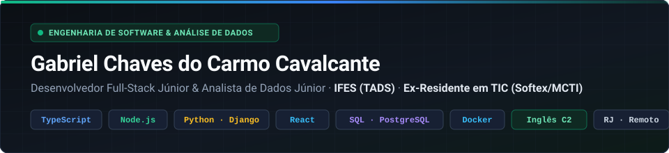
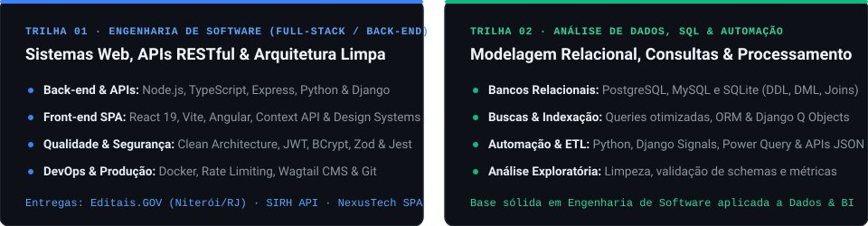
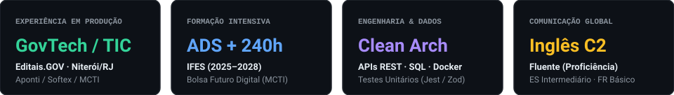

  

   

  

    
    
    
    
    
  

---

## 👨‍💻 Resumo Profissional

Sou **Desenvolvedor Full-Stack** e graduando em **Tecnologia em Análise e Desenvolvimento de Sistemas pelo IFES** (`2025 – 2028`), com experiência prática no desenvolvimento e na refatoração de aplicações web institucionais, APIs RESTful, modelagem de bancos de dados relacionais e automação de processos utilizando **TypeScript, Node.js, Python (Django), React e SQL (PostgreSQL, MySQL e SQLite)**.

Atuo na interseção entre **Engenharia de Software** e **Análise de Dados**: construo sistemas desacoplados sob **Clean Architecture** e conteinerizados com **Docker**, ao mesmo tempo em que estruturo consultas indexadas, pipelines de ingestão/limpeza de dados e automações que reduzem trabalho manual e apoiam a tomada de decisão.

  

---

## 💼 Experiência Profissional

### 🏛️ Residente em TIC — Desenvolvedor Full-Stack (`Editais.GOV`)
**Aponti / Softex / MCTI** · *Abr 2026 – Jun 2026* · *Rio de Janeiro, RJ*
- **Desenvolvimento & Refatoração Full-Stack:** Desenvolvi e refatorei módulos da plataforma institucional **Editais.GOV** para a **Prefeitura de Niterói/RJ**, utilizando **Python, Django e Wagtail CMS**.
- **Indexação de Dados & Automação de Processos:** Automatizei a organização estruturada de diretórios e documentos com **Django Signals** e implementei buscas avançadas e indexadas utilizando **Q Objects**, reduzindo operações manuais e acelerando a recuperação de informações públicas.
- **Segurança & Infraestrutura (DevOps):** Implementei políticas de **rate limiting** para proteção contra sobrecarga/abuso de requisições e conteinerizei o ecossistema com **Docker**, garantindo paridade entre ambientes de desenvolvimento e produção.

### 🚀 Formação em Desenvolvimento de Software — Bolsa Futuro Digital (240h)
**Aponti / Softex / MCTI** · *Ago 2025 – Jan 2026*
- Formação prática intensiva de 6 meses em Engenharia de Software, bancos de dados relacionais (**MySQL**) e arquitetura de sistemas.
- Desenvolvimento do projeto integrador final **SIRH (Sistema Integrador de Recursos Humanos)**: uma API RESTful corporativa em **TypeScript e Node.js** estruturada com **Clean Architecture**, validação com **Zod**, autenticação **JWT/BCrypt** e suíte de testes unitários com **Jest**.

---

## 📂 Projetos em Destaque

### 1. Engenharia de Software, APIs & Aplicações Web

| Projeto | Contexto & Arquitetura Técnica | Stack & Links |
| :--- | :--- | :--- |
| **[SIRH — API RESTful de Gestão de Contratos e RH](https://github.com/gccavalcante/projeto-integrador)** | API RESTful corporativa centralizando o ciclo de vida de clientes, serviços e contratos (`ACTIVE`, `PENDING`, `CANCELED`). Arquitetura em camadas (**Clean Architecture**: *Domain, Services/Use Cases, Adapters, Controllers*), autenticação **JWT + BCrypt**, validação de schemas com **Zod**, persistência em **MySQL** (`mysql2/promise`) e testes unitários com **Jest (`ts-jest`)** e **Biome**. | `TypeScript` `Node.js` `Express` `MySQL` `Clean Architecture` `JWT` `Zod` `Jest` 🔗 [Repositório API](https://github.com/gccavalcante/projeto-integrador) · [Schema SQL (`gestaorh.sql`)](https://github.com/gccavalcante/projeto-integrador/blob/main/gestaorh.sql) · [Front-end Angular](https://github.com/gccavalcante/projeto-integrador-front) |
| **[NexusTech Store — E-commerce SPA](https://github.com/gccavalcante/tads-store)** | Single Page Application simulando a jornada completa de e-commerce (catálogo com filtros dinâmicos e contadores, página técnica de produto com galeria e avaliações, carrinho reativo e checkout). Consumo assíncrono paralelo (`Promise.all`) da **DummyJSON API** e preenchimento automático de endereço via **ViaCEP**, estado global com **Context API** (`Auth`, `Carrinho`, `Favoritos`), persistência resiliente em `localStorage` e **Design System** próprio ([`DESIGN.md`](https://github.com/gccavalcante/tads-store/blob/main/DESIGN.md)). | `React 19` `Vite` `React Router v7` `Context API` `REST APIs` `CSS Tokens` 🔗 [Repositório GitHub](https://github.com/gccavalcante/tads-store) · [🚀 Live Demo (Vercel)](https://tads-store-gccavalcante.vercel.app/) · [Design System](https://github.com/gccavalcante/tads-store/blob/main/DESIGN.md) |
| **[Editais.GOV — Plataforma Institucional](https://github.com/gccavalcante)** *(Residência TIC)* | Evolução funcional e arquitetural de portal governamental para gestão e transparência de editais públicos da Prefeitura de Niterói/RJ, com foco em busca indexada, automação de diretórios via eventos e segurança de borda. | `Python` `Django` `Wagtail CMS` `Q Objects` `Signals` `Docker` |

---

### 2. Análise de Dados, SQL & Automação

Competências analíticas aplicadas em projetos e estrutura preparada para novos estudos de caso de **Data Analytics & BI**:

| Frente Analítica | Aplicação Prática & Escopo Técnico | Tecnologias |
| :--- | :--- | :--- |
| **[Modelagem Relacional & Consultas SQL](https://github.com/gccavalcante/Bolsa-Futuro-Digital)** | Modelagem de entidades, relacionamentos, constraints de integridade (chaves primárias/estrangeiras, unicidade de CNPJ/códigos), consultas com `JOIN`, filtros compostos, agregações e scripts DDL/DML aplicáveis a **MySQL**, **PostgreSQL** e **SQLite**. | `SQL` `MySQL` `PostgreSQL` `SQLite` `Modelagem Relacional` 🔗 [Scripts SQL & Práticas](https://github.com/gccavalcante/Bolsa-Futuro-Digital) · [Schema SIRH](https://github.com/gccavalcante/projeto-integrador/blob/main/gestaorh.sql) |
| **Automação, Ingestão & Busca Indexada em Python** | Tratamento e transformação de payloads JSON de múltiplas APIs, automação de fluxos operacionais com **Python / Django Signals**, consultas complexas via ORM (`Q Objects`) e exploração inicial de bases tabulares (`CSV`/`XLSX`) com Python e **Power Query**. | `Python` `Django ORM` `Power Query` `JSON / REST` `ETL` |
| **📌 Roadmap de Portfólio de Dados *(Em Preparação)*** | Novos estudos de caso em fase de estruturação e publicação: • **Pipeline ETL & Análise Exploratória (EDA):** Ingestão, tratamento, validação de qualidade e análise estatística de bases públicas com **Python (Pandas)** e **PostgreSQL**. • **Modelagem Dimensional & Dashboard de Negócios:** Construção de indicadores executivos (KPIs de vendas, retenção e operações) com **SQL**, **Power Query / Power BI** e documentação de insights. | `Python` `Pandas` `PostgreSQL` `Power Query` `Data Analytics` |

---

## 🛠️ Habilidades Técnicas & Ferramentas (ATS Matrix)

| Domínio | Tecnologias, Frameworks & Competências |
| :--- | :--- |
| **Linguagens de Programação & Consulta** |       |
| **Back-end & Engenharia de APIs** |        |
| **Front-end & UI Engineering** |      |
| **Bancos de Dados, BI & Analytics** |      |
| **Arquitetura, Qualidade & DevOps** |    -232F3E?style=flat-square&logo=amazonwebservices&logoColor=white) -C21325?style=flat-square&logo=jest&logoColor=white)   |

---

## 🎓 Educação, Formação Complementar & Idiomas

- 🎓 **Tecnologia em Análise e Desenvolvimento de Sistemas (TADS)** — *Instituto Federal do Espírito Santo (IFES)* · `Jun 2025 – Jun 2028 (em andamento)`
- 💻 **Residência em TIC — Desenvolvimento Full-Stack (Python/Django & Docker)** — *Aponti / Softex / MCTI* · `Abr 2026 – Jun 2026`
- 🛠️ **Formação em Desenvolvimento de Software (240 horas)** — *Bolsa Futuro Digital (Aponti / Softex / MCTI)* · `Ago 2025 – Jan 2026`
- 📈 **Trilha Contínua em Dados, SQL & Cloud** — *Aperfeiçoamento em Análise de Dados com Python, Modelagem SQL, Power Query e fundamentos de AWS*
- 🌍 **Idiomas:**
  - **Português:** Nativo
  - **Inglês:** Fluente (**Nível C2 — Proficiência**)
  - **Espanhol:** Intermediário
  - **Francês:** Básico

---

## 📊 Indicadores de Perfil

  

---

## 🤝 Contato & Disponibilidade

Estou aberto a oportunidades como:
- **Desenvolvedor Full-Stack Júnior** | **Engenheiro de Software Júnior** | **Desenvolvedor Back-end Júnior** (`TypeScript / Node.js / Python / Django / React`)
- **Analista de Dados Júnior** | **BI & Analytics Júnior** (`SQL / Python / PostgreSQL / MySQL / ETL`)

📍 **Rio de Janeiro, RJ** *(Disponível para atuação Remota, Híbrida ou Presencial)*

- 💼 **LinkedIn:** [linkedin.com/in/gabriel-chaves-](https://www.linkedin.com/in/gabriel-chaves-/)
- ✉️ **E-mail:** [gabrielccavalcante@gmail.com](mailto:gabrielccavalcante@gmail.com)
- 🌐 **Portfólio (NexusTech Live):** [tads-store-gccavalcante.vercel.app](https://tads-store-gccavalcante.vercel.app/)
